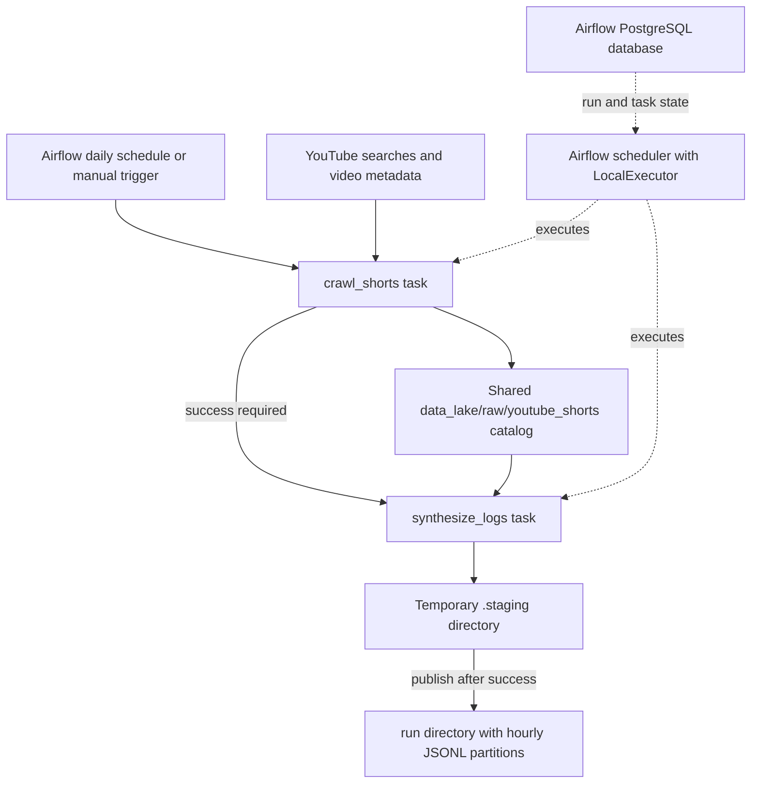

# Current crawling and synthetic user-log workflow

This document explains the code and configuration currently in this repository.
The pipeline collects YouTube video metadata, builds a local video catalog, and
generates synthetic user interactions against that catalog. Airflow schedules
and coordinates the two Python steps; Docker supplies their runtime environment.



## 1. What each file does

| File | Responsibility |
| --- | --- |
| [raw/crawl-short.py](raw/crawl-short.py) | Search for videos, filter and deduplicate them, and write metadata as JSONL. |
| [raw/user-logs.py](raw/user-logs.py) | Read the accumulated video catalog and generate simulated viewing sessions and intentionally noisy events. |
| [dags/shorts_user_logs.py](dags/shorts_user_logs.py) | Define the schedule, task dependency, retry policy, date window, and publication of completed log batches. |
| [Dockerfile.airflow](Dockerfile.airflow) | Build a Python environment containing Airflow and the pipeline dependencies. |
| [requirements-airflow.txt](requirements-airflow.txt) | Declare NumPy, pandas, and yt-dlp for that environment. |
| [docker-compose.yml](docker-compose.yml) | Configure containers, networking, environment variables, startup dependencies, and persistent storage. |
| [tests/test_raw_pipeline.py](tests/test_raw_pipeline.py) | Check crawler and simulator behavior offline. |
| [tests/test_airflow_workflow.py](tests/test_airflow_workflow.py) | Check DAG loading, task order, schedule settings, and simulation retry behavior. |

## 2. Crawling: building the video catalog

The entry point is `crawl_youtube_shorts()`. When run through Airflow, it receives
the script's `SEARCH_TOPICS`, a limit from `CRAWL_MAX_RESULTS_PER_QUERY`, the
container's catalog directory, and an Airflow run-specific batch name.

Its work proceeds as follows:

1. Create the output directory and scan its existing `*.jsonl` files.
   `load_existing_video_ids()` builds an in-memory set of already stored IDs.
2. Shuffle the categories and their seed queries. The actual dictionary contains
   **five categories with ten queries each**: tech, gaming, food, education, and
   music. The comment mentioning ten categories does not match the current code.
3. With 60% probability, add a random modifier such as `viral`, `tutorial`, or
   `2026` to each seed query.
4. Use yt-dlp's `ytsearchN:query` syntax to retrieve search metadata. This code
   uses yt-dlp rather than an authenticated YouTube Data API client.
5. Skip entries without an ID or duration, entries already seen, and entries
   outside the inclusive **5–60 second** duration range.
6. Try to enrich each accepted entry using its `/shorts/<video_id>` URL. If this
   detail request fails, log a warning and retain the available search metadata.
7. Merge metadata tags with hashtags extracted from the title and description,
   deduplicating tags without regard to case.
8. Append one JSON object per line to the current batch and add its ID to the
   in-memory set so later queries in the same run skip it.

With the Airflow default of ten results per query, the 50 searches request up to
roughly 500 candidate entries before filtering and deduplication. This is not a
promise of 500 stored videos. Duration and search keywords are the selection
heuristic; the script does not separately prove that every result is a Short.

Each stored record includes `video_id`, URL, title, description, channel fields,
`duration_seconds`, the assigned search category, tags, engagement counts,
upload date, thumbnail URL, and a UTC `crawled_at` timestamp. Missing detail
metadata can leave some fields empty or null. Video media is not downloaded.

The file in your editor, `3c1f5ccac6647665.jsonl`, illustrates the DAG's batch-name
format: the first 16 hexadecimal characters of SHA-256 applied to the Airflow
`run_id`. This is a run identifier, not a date or video ID.

The catalog accumulates across runs. Previously stored videos are skipped, so
their view and like counts are not refreshed on each daily run. If every search
fails, the function raises an exception for Airflow to retry. A non-`None`
search response counts as successful in the current implementation; the task
does not require a minimum number of newly written videos.

## 3. Simulation: turning videos into synthetic interactions

`run_user_simulation_pipeline()` reads **all JSONL batches** in the catalog
directory, deduplicates records by `video_id`, and constructs a pandas DataFrame.
It does not consume only the batch from the immediately preceding crawl task.
`video_id` connects the generated events back to the video catalog;
`duration_seconds` drives watch-time calculations.

An empty catalog raises an explicit error. The simulator then creates:

- One random eight-dimensional Dirichlet vector per synthetic user and video.
- A randomly sampled Zipf popularity score per video, normalized across the catalog.
- Internal DataFrame columns for video indices and popularity.

These vectors and popularity scores are newly sampled on each invocation. They
are not learned from titles, categories, actual engagement counts, or real users.
The same generated user ID on two daily runs does not have a persisted preference
vector. Randomness is not seeded, so fresh simulations are not reproducible.

### Sessions and events

For each simulated hour, a Poisson draw determines the number of sessions:

```text
session count ~ Poisson(60 × hourly activity multiplier)
```

The predefined multiplier varies by hour, with higher activity in the evening
of the simulation's clock. In the DAG that clock is UTC. Changing the number of
users changes the available user population; it does not directly scale the
session count.

For each session, the code chooses a user, creates a session ID, samples a
lognormal session length clipped to 1–30 video impressions, and samples videos
with replacement using probabilities proportional to `pop_score + 0.1`.

A sigmoid of the user/video vector dot product and popularity determines
affinity. Affinity affects whether the user watches roughly 80–180% of the
video duration or skips after a short watch. Other random rules generate likes,
shares, comments, comment-reading time, and profile clicks. Completion above
100% is possible because the model allows repeat viewing.

Each event contains identifiers, a `video_watch` type, impression index, watch
metrics, action flags, device/app fields, an event timestamp, and a server-receipt
timestamp. Session time advances by watch time, comment-reading time, and a short
gap, so a session may cross an hour or day boundary.

### Intentional noise

Approximately 12% of base events enter `inject_noise()`, which chooses one of
these modifications:

| Noise | Result |
| --- | --- |
| Block creator | Null watch metrics and set block/skip actions. |
| Duplicate event | Emit two copies with the same event ID and slightly different server timestamps. |
| Watch-time outlier | Insert 1–8 hours of watch time and a large completion value. |
| Negative timer | Set watch duration to `-1` and completion to null. |
| Missing user | Set `user_id` to null. |
| Offline clock skew | Move the event timestamp back two days while retaining its server timestamp. |
| Bot spam | Substitute a bot user, tiny watch metrics, and bot app version. |

These anomalies are part of the raw dataset for later data-cleaning exercises.
The outlier branch calculates completion using a fixed 15-second divisor, which
can intentionally disagree with the actual video's duration. A duplicate branch
also means the number of written records can exceed the base event count.

### Partitioning

Events are grouped by **UTC server-receipt time**, not the potentially skewed
event timestamp. Under Airflow, the final layout is:

```text
data_lake/raw/
  youtube_shorts/
    3c1f5ccac6647665.jsonl
  user_interaction_logs/
    run=<run-hash>/
      year=2026/month=10/day=21/hour=00/user_interactions_raw.jsonl
      year=2026/month=10/day=21/hour=01/user_interactions_raw.jsonl
      ...
```

The simulator itself appends records. The Airflow wrapper supplies a fresh
temporary output directory and publishes it only after the simulation succeeds.

## 4. Docker: the runtime and shared storage

### Image construction

`Dockerfile.airflow` starts from `apache/airflow:2.10.0-python3.11`, copies the
pipeline requirements, and installs them while explicitly retaining the base
image's Airflow version. The version-specific Python 3.11 constraints file
limits dependency resolution to compatible versions where packages are listed.
yt-dlp has no explicit version pin in the requirements file, so a future uncached
build can install a newer version. This follows the custom-image approach in
the [Airflow 2.10 Docker guide](https://airflow.apache.org/docs/apache-airflow/2.10.0/howto/docker-compose/index.html).

The resulting image is tagged `datamining-airflow:2.10.0`. The Dockerfile does not
copy the crawler or DAG into the image: Compose mounts them at runtime.
`.dockerignore` excludes `.git`, `.venv`, generated data/logs, and Python caches
from the build context. `.gitignore` separately keeps generated data and caches
out of version control.

### Airflow services

`x-airflow-common` and `airflow-environment` are YAML anchors that share the image,
mounts, and settings between the three Airflow services.

| Service | Role |
| --- | --- |
| `airflow-postgres` | PostgreSQL 16 metadata database storing Airflow run/task states and configuration. Its health check gates initialization. |
| `airflow-init` | Use the official image entrypoint to migrate the database and create the `admin` account, then run `version` and exit. |
| `airflow-webserver` | Serve the Airflow UI on host port 8080. Start after initialization completes successfully. |
| `airflow-scheduler` | Discover DAGs, schedule runs, and launch task processes through `LocalExecutor`. Start after initialization completes successfully. |

The scheduler container executes the Python work. The webserver is the control
and monitoring interface. This configuration has no separate Celery worker or
Redis broker. Airflow services connect to `airflow-postgres:5432` over the Compose
network; the metadata database has no host port mapping.

### Storage mapping

| Host directory or volume | Container location | Purpose |
| --- | --- | --- |
| `./dags` | `/opt/airflow/dags`, read-only | DAG definitions discovered by Airflow. |
| `./raw` | `/opt/airflow/raw`, read-only | Pipeline scripts loaded by the tasks. |
| `./data_lake` | `/opt/airflow/data_lake`, writable | Catalog and synthetic data, visible directly on the host. |
| `airflow_logs` named volume | `/opt/airflow/logs` | Airflow execution logs, distinct from synthetic interaction data. |
| `airflow_postgres_data` named volume | `/var/lib/postgresql/data` in the metadata service | Persistent Airflow database files. |

All three Airflow services receive the common mounts. With `LocalExecutor`,
sharing the filesystem lets the downstream task read the crawler's files without
passing their contents through Airflow's XCom mechanism.

### Other services in Compose

| Service | Intended platform role | Host port |
| --- | --- | --- |
| `postgres` (`postgres_dwh`) | PostgreSQL 18 warehouse, configured for logical replication. Separate from Airflow metadata. | 5432 |
| `minio` | Object storage and its console. | 9000 / 9001 |
| `zookeeper` | Coordination service used by the configured Kafka deployment. | 2181 / 2888 / 3888 |
| `kafka` | Event-stream broker. | 9092 |
| `debezium` | Kafka Connect runtime for change-data-capture connectors. | 8083 |
| `superset` | BI application connected to the warehouse's `superset` database. | 8088 |

The current DAG writes local JSONL files. It does not upload to MinIO, publish
Kafka messages, configure Debezium connectors, load warehouse tables, or refresh
Superset dashboards. Those services can be started separately when their stages
are implemented. The Compose credentials and webserver secret are local
development values. The dedicated Airflow database does not migrate old Airflow
history that may exist in the warehouse database.

## 5. Airflow: discovering, scheduling, and executing the DAG

The current `dags/` directory contains one DAG file defining `shorts_user_logs`.
`@dag` defines the workflow; its final `shorts_user_logs()` call instantiates it
for discovery. The two `@task` functions define the executable task bodies:

```python
crawl_shorts() >> synthesize_logs()
```

This dependency requires the crawl task to succeed before simulation starts.
At parse time, defining these tasks does not crawl YouTube or generate logs.
During task execution, `runpy.run_path()` loads the relevant script and retrieves
its function. This also handles the scripts' hyphenated filenames. Their CLI
blocks under `if __name__ == "__main__"` are not invoked by these calls.

| Setting | Current behavior |
| --- | --- |
| `schedule="@daily"`, UTC | A scheduled run becomes eligible after midnight UTC, or 07:00 Vietnam time. Actual task start can be later. |
| `start_date=2026-10-01 UTC` | Anchor the first data interval; it is not a command to run immediately. |
| `catchup=False` | Avoid automatically replaying every missed daily interval. |
| `max_active_runs=1` | Allow one active run of this DAG at a time. |
| `retries=2`, five-minute delay | Allow an initial attempt plus up to two retries per task. |
| Crawl timeout: six hours | Limit a crawl task execution attempt. |
| Simulation timeout: two hours | Limit a simulation task execution attempt. |
| Paused at creation | Require the DAG to be enabled for automatic scheduling. |

For a scheduled run eligible on **October 22, 2026 at 00:00 UTC**, the interval is
October 21 at 00:00 through October 22 at 00:00 UTC. The simulation receives
`data_interval_start` and `simulation_days=1`, so it begins its synthetic day on
October 21. A manual trigger also has an assigned interval; inspect the run's
interval rather than assuming it represents today's calendar date. These
semantics follow [Airflow's data-interval documentation](https://airflow.apache.org/docs/apache-airflow/2.10.0/core-concepts/dag-run.html).

The crawl task always fetches currently available metadata. It does not filter
YouTube results to the Airflow interval. Thus a historical simulation date can
use videos crawled later; this workflow is not a historical snapshot or a
time-correct recommendation evaluation dataset.

### Retries and completed output

Both tasks compute the same hash from `run_id`. A retry retains that ID; a new
DAG run gets a different ID.

For crawling, the batch is appended to, while IDs already written in the catalog
are skipped. Deduplication relies on readable local files. The crawler has no
atomic batch-publication step, and malformed JSONL can interrupt reading the
remainder of a file. Serialization protects against overlapping runs of this DAG,
but does not prevent a separately launched crawler from writing concurrently.

For simulation, the wrapper creates a `.staging-*` directory under the output
root. After successful generation, it renames the directory to `run=<hash>`.
An ordinary exception cleans up staging through the temporary-directory context.
A force-killed process may leave staging behind; downstream readers should
consume only completed `run=*` directories.

If the destination already exists, simulation returns its path without generating
again. Clearing that task in the same run therefore reuses its completed batch,
even after code changes. A new run creates another batch and can cover the same
date as an earlier run. Batch reuse prevents retry appends; it does not deduplicate
intentional noisy events or overlapping dates across different runs.

## 6. Starting, triggering, and monitoring

From PowerShell in the repository, with Docker Desktop running Linux containers:

```powershell
New-Item -ItemType Directory -Force data_lake | Out-Null
docker compose build airflow-init
docker compose up airflow-init
```

The build prepares the shared image. Initialization starts its healthy database
dependency, applies migrations, creates the administrator, and should exit with
code 0. Then start the long-running Airflow services:

```powershell
docker compose up -d airflow-webserver airflow-scheduler
```

Open http://localhost:8080 and log in with `admin` / `admin`. Enable
`shorts_user_logs` for scheduled runs. Use **Trigger DAG** for an immediate manual
run, then inspect the run's Graph/Grid view and each task's Logs tab. Enabling
the DAG can also schedule the latest eligible interval, so a manual trigger may
produce an additional queued run.

Useful commands:

```powershell
docker compose ps -a
docker compose exec airflow-scheduler airflow dags list
docker compose exec airflow-scheduler airflow dags list-import-errors
docker compose exec airflow-scheduler airflow dags unpause shorts_user_logs
docker compose exec airflow-scheduler airflow dags trigger shorts_user_logs
docker compose logs -f airflow-scheduler
```

The last command follows scheduler container output; per-task logs are available
through the UI. If crawling succeeds with no new videos, simulation still reads
the existing catalog. If crawling exhausts its retries and fails, simulation
does not run successfully downstream.

### Changing configuration

Compose defaults to ten search results per query and 1,000 users. Override them
in a repository `.env` file:

```dotenv
CRAWL_MAX_RESULTS_PER_QUERY=5
SIMULATION_NUM_USERS=100
```

Apply environment changes by recreating the services as needed:

```powershell
docker compose up -d airflow-webserver airflow-scheduler
```

Script and DAG edits are visible through the bind mounts; allow Airflow time to
reparse the DAG. Dependency changes require rebuilding and recreating the
services. Changing the schedule also requires considering the simulation window:
it is hard-coded to one day in the DAG.

### Running the scripts directly

```powershell
python -m pip install -r requirements-airflow.txt
python raw/crawl-short.py --max-results-per-query 5
python raw/user-logs.py --start-date 2026-10-21T00:00:00+00:00 --days 1 --num-users 100
```

| Option | Direct script default | DAG value |
| --- | --- | --- |
| Results per query | 50 | Environment value, default 10. |
| Crawl filename | Current UTC hour, `YYYYMMDDHH.jsonl`. | Run hash. |
| Simulation start | October 1, 2026, UTC. | Run's `data_interval_start`. |
| Simulation days | 3 | 1. |
| User count | 1,000 | Environment value, default 1,000. |
| Log publication | Append directly under the supplied output directory. | Stage, then publish a run directory. |

Airflow supplies scheduling, retries, dependency ordering, and completed-run
reuse; direct CLI invocations do not receive those protections.

## 7. What the tests verify

Tests are separate from DAG execution. Neither the Dockerfile nor the DAG runs
them automatically; invoke them during development or from a future CI job.

| Test | What it checks |
| --- | --- |
| `test_retry_skips_existing_video_ids` | Two mocked crawls store the same video only once. |
| `test_all_failed_queries_raise` | A total mocked search failure raises an exception. |
| `test_empty_catalog_fails_clearly` | Missing input videos produce an explicit error. |
| `test_requested_window_users_and_timestamp_partitions` | A small simulation writes events for catalog videos, uses the requested user range and time window, and partitions by server timestamp. |
| `test_dependency_and_schedule` | `DagBag` parses the DAG without import errors and verifies task order, daily schedule, disabled catchup, and one active run. |
| `test_failed_attempt_then_retry_and_completed_output_reuse` | An interrupted fake simulation publishes nothing; a later invocation publishes successfully; another invocation reuses that output. |

The raw tests mock yt-dlp, use temporary files, and reduce session counts by
patching the Poisson draw. The Airflow retry test invokes the task's Python
callable with a mocked context and fake generator. It verifies the wrapper's
publication behavior, rather than waiting for real scheduler retries.

Run locally with the pipeline dependencies installed:

```powershell
python -m unittest discover -s tests -v
```

If Airflow is unavailable locally, the two Airflow tests are skipped. Run all
six in the built image using a disposable container:

```powershell
docker run --rm --entrypoint python --mount "type=bind,source=${PWD},target=/workspace,readonly" --workdir /workspace datamining-airflow:2.10.0 -m unittest discover -s tests -v
```

This test container does not require the Compose database or start the scheduler.
The build and all six tests passed during the initial implementation. Those
checks do not establish live YouTube availability, a complete running-stack
integration, or correctness of future MinIO/Kafka/warehouse stages.
